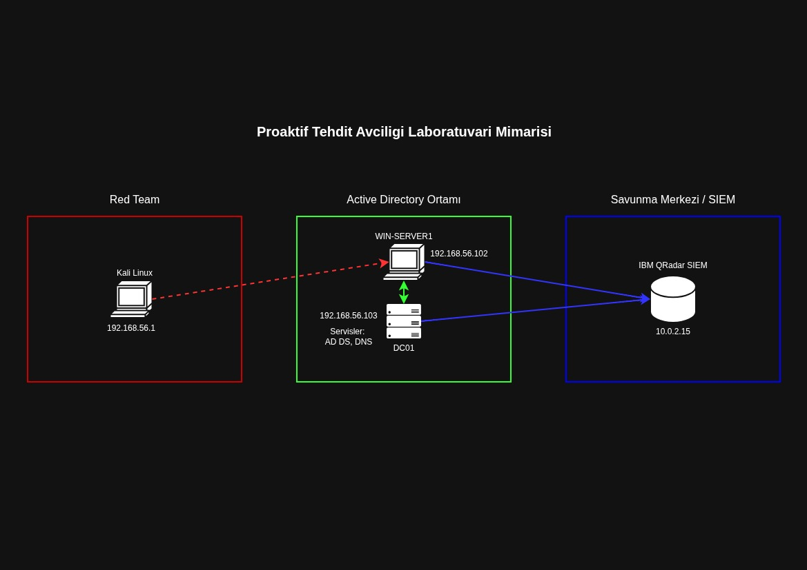
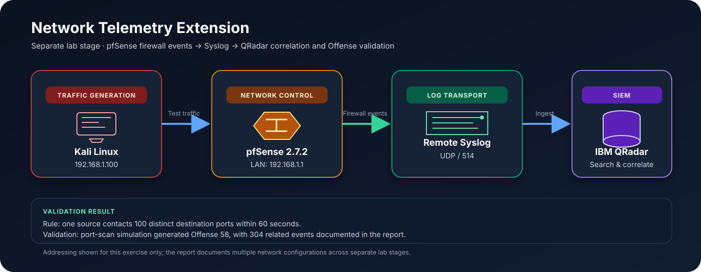

# SOC Internship — Threat Emulation, SIEM Engineering & Detection Development

A technical portfolio summary of a hands-on Security Operations Center (SOC) internship, covering an isolated Active Directory lab, Windows telemetry collection, adversary emulation, IBM QRadar SIEM investigations, detection-rule engineering, and threat-hunting research.

> **Full technical report:** [`docs/SOC_Internship_Report.pdf`](docs/SOC_Internship_Report.pdf) — the 149-page report contains the extended walkthroughs, screenshots, event payloads, and supporting research.

> **Lab-only notice:** Attack simulations described here were performed or studied in a controlled virtual lab for defensive validation. This repository is a learning portfolio, not a guide for testing systems without authorization.

---

## Overview

The main practical goal was to build a small, instrumented Windows domain environment, execute controlled attack simulations, and follow the resulting telemetry from endpoint and network sources into QRadar. The work emphasized the complete detection lifecycle rather than exploitation alone:

**Prepare the lab → generate controlled activity → collect telemetry → inspect raw events → map behavior to MITRE ATT&CK → build detections → validate alerts → tune false positives.**

The report combines four workstreams:

1. **Lab engineering:** Windows Server, Active Directory Domain Services (AD DS), DNS, Group Policy, Sysmon deployment, Windows Event Forwarding (WEF), WinCollect, and virtual networking.
2. **Adversary emulation:** Controlled simulations across discovery, execution, persistence, credential access, lateral movement, command and control, collection, exfiltration, defense evasion, and recovery inhibition.
3. **SIEM detection engineering:** QRadar raw-payload analysis, Sigma rules, custom correlation rules, Offense validation, regex-based field extraction, and false-positive tuning.
4. **Threat research:** MITRE ATT&CK mapping, APT29/Nobelium, Lazarus Group/APT38, MuddyWater, log-source fundamentals, SIEM vs. EDR, and incident-response concepts.

## Highlights

- Built a virtual Active Directory environment for repeatable detection experiments.
- Used Group Policy to plan and distribute Sysmon and its configuration centrally.
- Forwarded Windows security and system events into IBM QRadar using WEF/WinCollect-based collection.
- Simulated **15 primary Windows/network behavior scenarios**, plus an additional regsvr32/ATT&CK emulation test, and documented the associated telemetry and ATT&CK mappings.
- Authored **three Sigma detection examples** for firewall disablement, SMB/PsExec-style lateral movement, and shadow-copy deletion.
- Created and validated QRadar custom rules for recovery inhibition, firewall changes, administrative-share activity, network port scanning, and authentication anomalies.
- Verified alert generation in several scenarios, including documented QRadar Offenses **49, 50, 52, 58, and 61**.
- Investigated Active Directory credential and Kerberos attack patterns using Windows Event IDs and QRadar payload fields.
- Built a separate pfSense-to-QRadar syslog exercise and a Linux command-line parsing workflow.

## Lab Architecture

### Primary Active Directory / SOC lab



The original report's topology depicts a Kali Linux red-team host, a Windows Server endpoint, an Active Directory/DNS server, and IBM QRadar SIEM. The diagram above is a cleaned-up portfolio illustration of that design. Windows endpoint telemetry (Windows Security events and Sysmon data) is forwarded for centralized search, correlation, and detection validation.

### Additional network-telemetry exercise



A separate report section documents pfSense 2.7.2 forwarding selected firewall events to QRadar by remote Syslog over UDP/514. Nmap-generated traffic was used to verify ingestion and test a port-scan correlation rule. This is shown separately because the report records distinct network configurations across lab stages.

### Addressing and naming notes

The report contains configuration details from more than one lab stage. The primary topology labels the domain controller as **DC01**, while later event analysis refers to **DC02.internlab.project**. Likewise, the primary topology and the later pfSense exercise use different addressing contexts, including an address reused across separate configuration descriptions. These differences should be reconciled before recreating the lab; this README intentionally describes the system roles without claiming a single definitive hostname/IP mapping for every stage.

## Telemetry and Detection Workflow

### Windows endpoint and domain telemetry

- **Active Directory / DNS:** Centralized identity, domain services, and authentication context.
- **Group Policy (GPO):** Centralized deployment approach for Sysmon and its configuration, and policy-based audit configuration.
- **Sysmon:** Process and endpoint activity visibility using a SwiftOnSecurity-based configuration.
- **Windows Event Forwarding (WEF) and WinCollect:** Collection/forwarding path for selected Windows event data.
- **QRadar Log Activity:** Event filtering, normalized-field review, raw-payload investigation, and source validation.

### Network and Linux telemetry

- **pfSense:** Configured WAN/LAN interfaces, firewall rules, and remote Syslog forwarding for firewall events.
- **Syslog / UDP 514:** Used in the pfSense-to-QRadar integration exercise.
- **Kali Linux:** Generated controlled traffic and provided host-side log sources for additional experiments.
- **iptables logging:** A custom `Linux-Ping-Out` label was used to make selected outbound ICMP activity easy to identify in logs.
- **Regex / Custom Event Property:** Extracted command-line text from a raw payload using the pattern `CommandLine=(.*?) Action=` and exposed it as a field for search and correlation.

### Analysis sequence

1. Confirm the source system generated the expected event.
2. Locate the matching event in QRadar.
3. Inspect normalized fields and raw payload details.
4. Correlate timestamp, account, source IP, logon type, process/command line, service, and event identifier.
5. Map the behavior to an ATT&CK technique where appropriate.
6. Build or tune a detection rule.
7. Re-run the scenario and verify whether an Offense is created.

## Adversary Emulation Coverage

The main hands-on scenario chapter documents the following controlled behaviors. Technique IDs below follow the mappings used in the report; the full report contains additional context and screenshots.

| Behavior / scenario | ATT&CK mapping documented in the report | Defensive validation focus |
|---|---|---|
| Active network scanning | T1595 / T1595.001 | Repeated connection attempts and Windows Filtering Platform Event ID 5156 |
| Payload staging and transfer | T1608 / T1608.001 | HTTP transfer, PowerShell download behavior, and outbound network logs |
| Domain-account use over RDP | T1078 / T1078.002 | Source/destination context and RDP port 3389 activity |
| Scheduled-task creation | T1053.005 | Process creation and `schtasks.exe` activity |
| Registry Run-key persistence | T1547.001 | Registry command-line activity and persistence-related events |
| Windows service creation | T1543.003 | New service installation and Event ID 7045 |
| Shadow-copy deletion | T1070.004 / T1490 | `vssadmin` command-line visibility and recovery-inhibition behavior |
| Windows Firewall disablement | T1562.004 in the detection sections | `netsh advfirewall` behavior and rule-generated alerts |
| Password guessing / brute force | T1110.001 | Repeated failed logons, Event ID 4625, account and logon-type context |
| System information discovery | T1082 | `systeminfo` and related command-line telemetry |
| SMB administrative-share lateral movement | T1021.002 | ADMIN$ access, PsExec/Impacket-style service traces, and Event ID 7045 |
| Data staging through archiving utilities | T1560.001 | PowerShell `Compress-Archive` and archive creation activity |
| HTTP beaconing / web-protocol C2 simulation | T1071.001 | Periodic outbound requests and network connection events |
| Exfiltration over unencrypted alternative protocol | T1048.003 | Raw TCP/Netcat traffic and outbound data-transfer telemetry |
| Recovery inhibition | T1490 | Shadow-copy deletion detection and QRadar Offense validation |
| Regsvr32 / Squiblydoo research simulation | T1218.010 | Suspicious process execution and QRadar Offense generation |

These simulations were used to understand both **Red Team behavior** and the **Blue Team visibility required to detect it**. The report distinguishes successful test execution from cases where the main result was establishing a baseline or developing a detection hypothesis.

## Sigma Detection Examples

Three Sigma rule examples are included in the report:

1. **Windows Firewall disablement** — detects the suspicious `netsh.exe` / `advfirewall` / `allprofiles` / `state off` command pattern.
2. **SMB / PsExec-style lateral movement** — looks for traces such as `PSEXESVC`, `winexesvc`, and `ADMIN$` access.
3. **Shadow-copy deletion** — looks for `vssadmin.exe`, `delete`, `shadows`, and `/quiet` indicators.

These are educational starting points. In a production detection pipeline, rule logic should be validated against the actual event schema, command-line field availability, data source, environment baseline, and false-positive profile before deployment.

## QRadar Custom Correlation Rules and Validation

| Detection use case | Rule approach described in the report | Validation evidence |
|---|---|---|
| Shadow-copy deletion / recovery inhibition | Match relevant `vssadmin` deletion tokens in event payloads | A QRadar Offense was generated; report documents Offense 49 and raw-payload verification |
| Firewall disablement | Correlate `netsh advfirewall` and firewall-profile disablement indicators | QRadar Offense generation was verified; report details Offense 50 and related summary alerts |
| Administrative-share / lateral movement activity | Monitor ADMIN$-related access and command/service traces | Relevant command and event payload were found; rule tuning and exception handling were also explored |
| Network port scanning through pfSense | Same source IP reaching 100 distinct destination ports within one minute | Port-scan simulation generated Offense 58; the report records 304 related events |
| Linux SSH brute force | Five failed authentication events from the same source within one minute | Offense 61 was documented for the repeated-failure scenario |
| Successful authentication to sensitive services | Correlate successful authentication to ports 22, 3389, and 443, with a trusted-source exception | The report describes correlation between repeated failures and later successful logons |
| Process / command-line analysis | Parse the command-line field into a custom QRadar event property | Extracted command data became directly searchable and reusable by correlation rules |

### Rule tuning and event quality

The report also covers why parsed event categories and structured fields are preferable to repeated raw-payload substring searches when suitable fields are available. Exceptions were considered for trusted sources to reduce false positives and alert fatigue. Tuning must preserve visibility into real threats and should be documented alongside rule changes.

## Active Directory and Kerberos Detection Research

A dedicated section investigates common credential-access and identity-abuse patterns in a controlled domain environment. The main emphasis is on what can be observed in Windows Security logs and how those events can be searched in QRadar.

| Scenario | Telemetry and investigation themes documented |
|---|---|
| Pass-the-Hash | Event ID 4624, Logon Type 3, NTLM authentication, source-address context |
| Pass-the-Ticket | Kerberos ticket-cache inspection; Event ID 4768 / TGT request visibility and QRadar parsing |
| Kerberoasting | Event ID 4769, service principal name (SPN), service-account context, and RC4 encryption type `0x17` as a hunt signal |
| AS-REP Roasting | Event ID 4768, `Pre-Authentication Type = 0`, target account, source address, and encryption-type context |
| Golden Ticket indicators | Hunting for unusual TGS requests, including 4769 activity without an expected preceding 4768; contextual correlation is required |
| Silver Ticket indicators | Baseline comparison of successful logons and the presence/absence of expected Kerberos ticket events |
| NTLM relay analysis | Successful and failed SMB baselines, Event IDs 4624/4625, Logon Type 3, NTLM package, source and workstation context |
| DCShadow detection research | Event ID 5136 baseline for normal directory changes and investigation of possible visibility gaps for replication-based changes |

The report also discusses why a single event is rarely sufficient to prove a sophisticated attack. For example, Event ID 4624 can represent legitimate or suspicious access; source host, authentication package, logon type, expected preceding events, service context, and baseline behavior must be considered together.

## Audit Policy, Event Analysis, and SIEM Operations

The report includes practical review of central audit configuration and QRadar operations:

- Central audit policies through Group Policy, including Advanced Audit Policy Configuration.
- Object Access auditing for folders and shared resources.
- Event payload anatomy: timestamp, event identifier, user/account, process ID, process name, access mask, handle, object path, source IP, and authentication package.
- QRadar Log Activity, Offenses, dashboards/Pulse, asset profiles, reference data, rule exploration, and other administrative areas.
- Log source categories spanning QRadar internal logs, Microsoft/Windows servers, network/perimeter devices, endpoints, and cloud services.
- DHCP and DNS logs as sources of attribution, suspicious lookup patterns, and network investigation context.
- SIEM vs. EDR roles, emphasizing centralized multi-source correlation versus endpoint-level behavior visibility and response.
- Incident-response concepts and the importance of distinguishing true positives, false positives, and benign administrative activity.

### Windows Event IDs referenced frequently

| Event ID | Use in the report |
|---|---|
| 4624 | Successful logon; interpret with logon type and authentication package |
| 4625 | Failed logon; useful for password-guessing and authentication analysis |
| 4672 | Special privileges assigned to a logon |
| 4688 | Process creation; command-line auditing improves investigation value |
| 4720 | User account creation |
| 4768 | Kerberos Ticket Granting Ticket (TGT) request |
| 4769 | Kerberos service-ticket (TGS) request |
| 5136 | Active Directory object modification |
| 5156 | Windows Filtering Platform permitted a connection |
| 7045 | New Windows service installed |
| 1102 / 104 | Security/System log-clearing signals discussed in the report |

Event IDs are interpreted with the accompanying payload and lab context; an identifier alone should not be treated as definitive evidence of malicious activity.

## Network Logging Extension: pfSense and Linux

The report documents an additional network-telemetry exercise using pfSense **2.7.2-RELEASE**:

- Configured WAN and LAN interfaces and reviewed firewall rules.
- Forwarded selected firewall events using Remote Syslog over **UDP/514**.
- Configured a corresponding QRadar log source using the pfSense DSM and Syslog protocol.
- Generated test traffic from Kali Linux and confirmed that firewall permit events reached QRadar.
- Built a correlation condition for one source contacting 100 distinct destination ports within one minute and validated the resulting port-scan Offense.
- Forwarded selected Kali Linux system/kernel logs and verified their visibility in QRadar.
- Used a custom label for outbound ICMP logging and regex-based extraction of command-line text into a structured custom event property.

## Threat Intelligence and Research Topics

The report includes supplemental research beyond the hands-on lab:

- **APT29 / Cozy Bear / Nobelium:** spear-phishing, HTML smuggling, Mark-of-the-Web considerations, abuse of legitimate cloud services for command-and-control, and Cyber Kill Chain mapping.
- **Lazarus Group / APT38:** supply-chain compromise, LSASS credential access, and destructive impact.
- **MuddyWater:** public-facing application exploitation, PowerShell execution, and scheduled-task persistence.
- Mapping adversary Tactics, Techniques, and Procedures (TTPs) to MITRE ATT&CK.
- Common log-source types and key Windows/Linux/network telemetry.
- QRadar regex capture groups and performance considerations.
- A high-level discussion of Turkey's Law No. 5651 and SOC log-management responsibilities.

These appendix topics are presented as research and operational reference notes, distinct from the directly tested lab scenarios.

## Tools and Technologies

| Area | Tools / technologies used or studied |
|---|---|
| Virtual lab | Oracle VirtualBox, Windows Server, Kali Linux |
| Identity and policy | Active Directory Domain Services, DNS, Group Policy, Advanced Audit Policy |
| Endpoint telemetry | Sysmon, Windows Security Event Logs, Windows Event Forwarding, WinCollect |
| SIEM and detections | IBM QRadar SIEM, QRadar AQL/search, custom correlation rules, Sigma |
| Adversary emulation | Atomic Red Team, APTSimulator, MITRE ATT&CK; MITRE CALDERA researched |
| Network and host tools | Nmap, Wireshark, pfSense, Netcat, PowerShell, Hydra, xfreerdp |
| Identity/security testing | Impacket, NetExec, Kerberos utilities (`kinit`, `klist`, `kvno`), `ldapsearch` |
| Parsing and investigation | Syslog, regex capture groups, raw-payload analysis, custom event properties |

## Repository Structure

```text
SOC-Internship-Portfolio/
├── README.md
├── images/
│   ├── soc-lab-topology.jpeg
│   └── network-telemetry-flow.svg
└── docs/
    └── SOC_Internship_Report.pdf
```


## Key Takeaways

This internship project strengthened practical understanding of SOC workflows by connecting attack simulation to telemetry, investigation, and detection validation. The central lesson was that a useful detection requires more than a suspicious command: it depends on adequate logging, reliable parsing, context-aware correlation, and iterative tuning against benign activity.

**Focus areas:** `SOC Operations` · `SIEM` · `IBM QRadar` · `Sysmon` · `Windows Event Logs` · `MITRE ATT&CK` · `Sigma` · `Threat Hunting` · `Active Directory` · `Detection Engineering`

---
